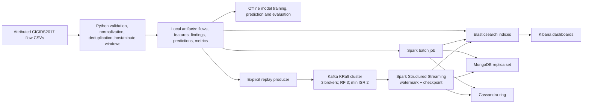
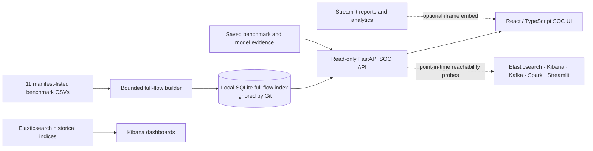

# Cyber Threat Lab — as-built architecture

This overview separates the **historical flow-processing pipeline** from the **host-side SOC/reporting applications**. It describes the repository implementation, not a production deployment.

## 1. Historical flow pipeline

The base Python pipeline and Elasticsearch/Kibana pair are separate from the optional `bigdata` Compose profile. Spark batch reads saved artifacts; streaming consumes events only after the replay/producer path writes Kafka. Batch and stream results are persisted independently to Elasticsearch, MongoDB and Cassandra. Kibana queries Elasticsearch; it does not query the SOC SQLite store.

## 2. Host-side SOC and reporting plane

The SOC full-flow API reads the local SQLite index built from the expanded benchmark and serves bounded, server-side queries. It does **not** silently fall back to the smaller Thursday-only flow capture, and the expanded full-flow dataset is not indexed into Elasticsearch by this feature. The API also reads saved artifacts and performs actual, point-in-time health probes; reachability is not evidence of ingestion, freshness, consumer lag or throughput. The React dashboard can run directly or be embedded by the Streamlit SOC route. Streamlit reports, Kibana dashboards and the React SOC remain distinct application surfaces.

## 3. Boundaries and operating model

- **Historical evidence is not live telemetry.** Dataset timestamps, saved findings and replays retain their historical context. No packet capture or attack-traffic generation is started by the SOC UI.
- **The expanded full-flow index is local-only.** Its multi-gigabyte SQLite database and raw datasets are ignored by Git; a clean clone requires local data preparation before full-flow routes become ready.
- **Local development only.** Compose-published service ports bind to `127.0.0.1`. The Compose stack deliberately disables Elasticsearch security for this isolated lab; do not expose it or treat it as production-hardened.
- **Optional services are not implied to be running.** Kafka, Spark, MongoDB and Cassandra use the `bigdata` profile; SOC health cards report observed reachability rather than assuming service health.
- **Evaluation caveats remain attached to evidence.** The Thursday-only pipeline and expanded multi-capture benchmark are separate experiments. Metrics do not become synthetic flow events or per-flow predictions.

## Diagrams and implementation references

- [Editable main pipeline diagram](../diagrams/cyberlab-architecture.drawio)
- [SOC platform diagram](soc-architecture.html)
- [SOC implementation and limitations](soc-platform-plan.md)
- [Project ownership and operating boundaries](project-structure.md)
- [Compose services](../compose.yaml)
